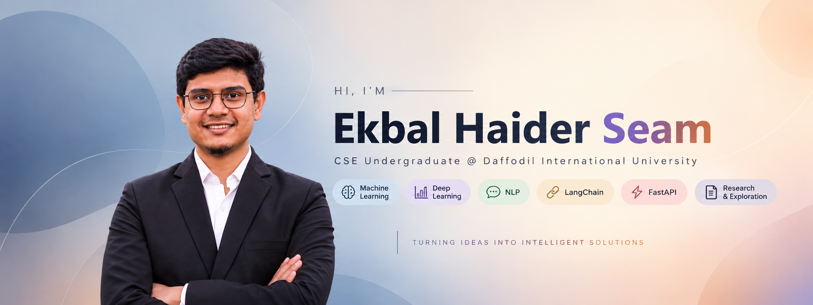

<!-- ===================== BANNER ===================== -->

<p align="center">
  
</p>

<!-- ===================== INTRODUCTION ===================== -->

<h1 align="center">Hi 👋, I'm Ekbal Haider Seam</h1>

<h3 align="center">
  CSE Undergraduate | AI & Machine Learning Enthusiast | Exploring AI Research
</h3>

<p align="center">
  <i>Building, learning, and exploring intelligent systems through code and research.</i>
</p>

<br/>

<!-- ===================== ABOUT ME ===================== -->

## 👨‍💻 About Me

I'm a **Computer Science & Engineering undergraduate at Daffodil International University**, with a growing interest in **Artificial Intelligence, Machine Learning, Deep Learning, and AI-driven applications**.

I enjoy learning how intelligent systems work, implementing concepts through hands-on projects, and gradually exploring the research side of AI.

My current journey involves strengthening my foundations in **Machine Learning and Deep Learning**, experimenting with **NLP and LLM-based applications**, and building practical AI solutions using tools such as **LangChain and FastAPI**.

- 🎓 Studying **Computer Science & Engineering** at **Daffodil International University**
- 🤖 Interested in **Artificial Intelligence, Machine Learning & Deep Learning**
- 🧠 Exploring **ANN, CNN, RNN, LSTM and NLP**
- 🔗 Building and experimenting with **LangChain & LLM-based applications**
- ⚡ Learning to develop AI-powered APIs and applications using **FastAPI**
- 🔬 Currently exploring **AI/ML research and research methodologies**
- 📚 Continuously learning through projects, experimentation, and research

<br/>

<!-- ===================== CURRENT FOCUS ===================== -->

## 🎯 Current Focus

```text
Machine Learning        → Building stronger ML foundations
Deep Learning           → ANN • CNN • RNN • LSTM
Natural Language        → NLP • LLM Applications
AI Development          → LangChain • FastAPI
Research                → Exploring AI/ML research
```

<br/>

<!-- ===================== TECH STACK ===================== -->

## 🧰 Tech Stack & Skills

### 🧠 AI, Machine Learning & Data

<p align="left">
  
  &nbsp;
  
  &nbsp;
  
  &nbsp;
  
  &nbsp;
  
</p>

### 🤖 AI Development & Frameworks

<p align="left">
  
  &nbsp;
  
  &nbsp;
  
</p>

### 💻 Programming & Development

<p align="left">
  
</p>

### 🛠️ Tools

<p align="left">
  
</p>

<br/>

<!-- ===================== AREAS OF INTEREST ===================== -->

## 🔬 Areas of Interest

<p align="center">

`Machine Learning` •
`Deep Learning` •
`Artificial Neural Networks` •
`CNN` •
`RNN` •
`LSTM`

`Natural Language Processing` •
`Large Language Models` •
`LangChain` •
`AI Applications`

`AI/ML Research` •
`Intelligent Systems`

</p>

<br/>

<!-- ===================== FEATURED PROJECTS ===================== -->

## 🚀 Featured Projects

<table>
<tr>
<td width="50%" valign="top">

### 📚 StudyMate AI

An AI-powered study assistant exploring modern **LLM application development** and intelligent learning experiences.

**Technologies**

`Python` `LangChain` `LLM` `Streamlit`

<a href="https://github.com/seamhaider/StudyMate-AI">
  
</a>

</td>

<td width="50%" valign="top">

### 🤖 Machine Learning Projects

Hands-on machine learning projects created while exploring **data preprocessing, model training, evaluation, and prediction**.

**Technologies**

`Python` `Pandas` `NumPy` `Scikit-learn`

<a href="https://github.com/seamhaider/ML_Project">
  
</a>

<br/><br/>

<a href="https://github.com/seamhaider/ML_Project_2">
  
</a>

</td>
</tr>

<tr>
<td width="50%" valign="top">

### 🔗 LangChain Learning

Experiments and implementations created while learning **LangChain** and understanding the development of LLM-powered applications.

**Technologies**

`Python` `LangChain` `LLM`

<a href="https://github.com/seamhaider/LangChain_Module">
  
</a>

</td>

<td width="50%" valign="top">

### 🔬 Research Journey

Currently developing my understanding of **AI/ML research**, research methodologies, experimentation, and technical literature.

> More research-oriented work and projects coming as I continue learning and experimenting.

</td>
</tr>
</table>

<br/>

<!-- ===================== GITHUB STATS ===================== -->

## 📊 GitHub Analytics

<p align="center">
  
  
</p>

<br/>

<!-- ===================== GITHUB STREAK ===================== -->

## 🔥 GitHub Streak

<p align="center">
  
</p>

<br/>

<!-- ===================== ACTIVITY GRAPH ===================== -->

## 📈 Contribution Activity

<p align="center">
  
</p>

<br/>

<!-- ===================== CONNECT ===================== -->

## 🤝 Connect With Me

<p align="center">

<a href="mailto:ekbalhaiderseam@gmail.com">
  
</a>

<a href="https://www.linkedin.com/in/ekbalhaiderseam">
  
</a>

<a href="https://github.com/seamhaider">
  
</a>

</p>

<br/>

<!-- ===================== PROFILE VIEWS ===================== -->

<p align="center">
  
</p>

---

<p align="center">
  <i>Learning continuously • Building thoughtfully • Exploring intelligently</i>
</p>
